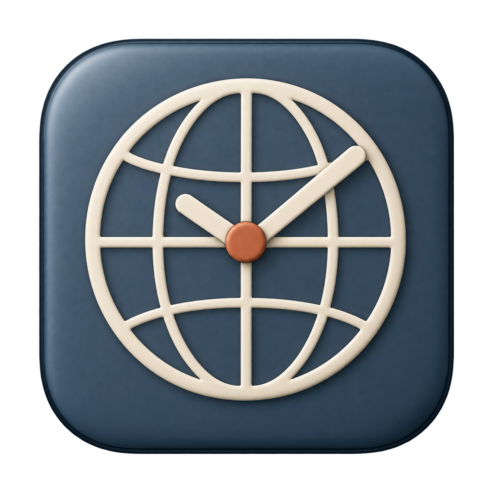
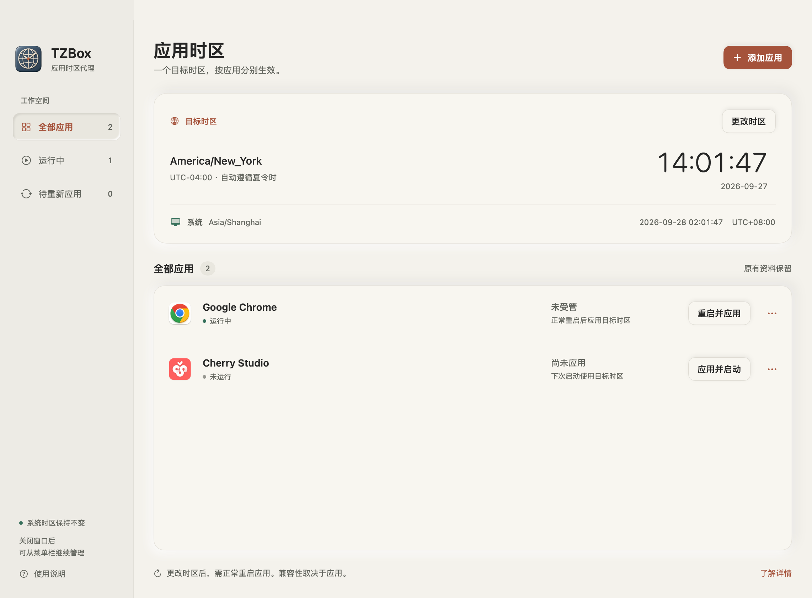
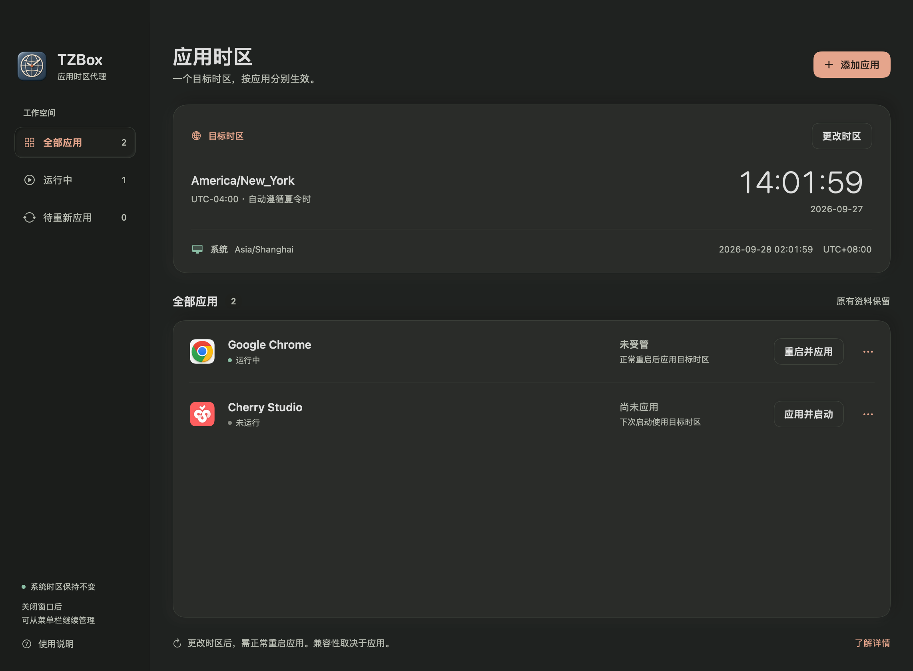
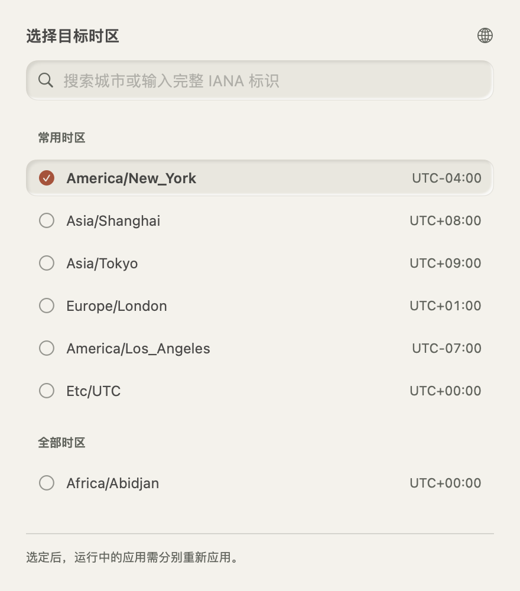

<p align="center">
  
</p>

# TZBox

**同一个真实时刻，按你选择的时区运行应用。**

TZBox 是 macOS 原生应用级时区代理：选择时区、添加应用，再正常启动或重启。系统时区保持不变，应用继续使用自己的资料、账号和设置。

## 能做什么

- 为 Chrome、Cherry Studio 和其他 macOS `.app` 统一设置启动时区。
- 搜索 IANA 时区，实时对照目标时间与系统时间，按当地规则处理夏令时。
- 查看每个应用的实际启动时区、运行状态和“待重新应用”提示。
- 正常重启以应用新时区，或恢复系统时区；应用拒绝退出时保留原实例。
- 关闭窗口后留在菜单栏。退出 TZBox 不会关闭已启动的应用，重新打开可恢复存活会话的识别。

所有应用采用相同的 `NSWorkspace + TZ` 启动机制。产品不创建专用 Chrome 资料，不使用 CDP 覆写页面、不注入第三方代码，也不改写网络请求。

## 界面

暖色画布、陶土色强调与柔和层次，让目标时区、系统时间和应用状态保持清楚。图标源图与生成记录见 [图标资产](Assets/AppIcon/GENERATION.md)，界面与交互约定见 [设计说明](docs/DESIGN.md)。



<details>
<summary>深色模式与时区选择器</summary>





</details>

## 构建

需要 **macOS 14 或以上、Apple Silicon、Swift 5.9 或以上，以及已安装的 macOS SDK / Command Line Tools**。构建没有第三方运行时依赖，不需要 Rust 或 Python。

```sh
git clone https://github.com/pifuyuini/tzbox.git
cd tzbox
./scripts/build.sh release
open build/TZBox.app
```

应用输出为 `build/TZBox.app`。构建使用 Swift Package Manager；仅装 Command Line Tools 且 SwiftPM 的 PlatformPath 查询不可用时，自动使用现有 `swiftc` 编译相同源码。脚本不会安装工具或修改系统开发配置。

图标从仓库的透明 PNG 通过系统 `sips` 和 `iconutil` 生成全部标准尺寸，并与源 PNG 一起打包。应用使用本地 ad-hoc 签名；Developer ID 签名、公证和自动更新尚未提供。版本与打包步骤见 [发布说明](docs/RELEASE.md)。

## 使用

1. 打开 TZBox，选择目标时区，例如 `Asia/Tokyo`。
2. 点击“添加应用”，选择应用的 `.app`。
3. 未运行的应用可直接应用并启动；已运行的应用需要保存内容并确认正常重启。应用自己的保存提示需手动处理，TZBox 不强制结束进程。
4. 修改目标时区后，已有进程继续显示原启动时区。为各应用重新应用后，新目标才生效。
5. 在应用菜单选择恢复系统时区，会正常退出该实例，再以不设置 `TZ` 的环境启动。

从 Dock 或其他外部入口启动、自行重启的应用显示为未受管。运行记录不能证明其启动环境时，TZBox 不推断时区。

设置、运行记录和历史报告位于 `~/Library/Application Support/TZBox`。应用操作尚未完成时不能退出 TZBox；记录保存失败时可重试。损坏记录通过明确的恢复操作保留备份，不会静默覆盖原件。

## 效果与边界

**需要正常重启，不支持无重启接管任意运行中应用。**“已应用到启动环境”表示本次启动传入了目标时区，不能证明应用全部功能均采用它。网页、Worker、扩展、原生界面、服务器和远程工具需分别验证。

当前实机证据来自 macOS 14.4、Chrome 154.0.8037.57 与 Cherry Studio 2.0.8。最终联合验收通过 157 项检查，包括时区切换、恢复系统环境、真实时间戳，以及隔离测试资料跨重启保留。完整范围、未验证项目和证据说明见 [验证记录](docs/VALIDATION.md)。

Cherry Studio 普通聊天的实际请求中，`{{datetime}}` 随目标时区变化；`{{timezone}}` 仍为未解析文本，请求没有独立 timezone 字段。TZBox 不补造字段，模型回答也不能代替实际请求证据。账号设置、服务器提供的时间和远程执行环境可能独立于本机时区。

## 验证与开发

```sh
./scripts/test.sh
./scripts/test.sh --native-probe
```

自有测试还需要 `.venv/bin/python`；Python 辅助程序使用标准库，脚本不会安装依赖。首次克隆后，可用已安装的 Python 3.12 执行 `python3.12 -m venv .venv` 创建测试环境；已有环境无需重建。SwiftPM/XCTest 可用时执行标准测试；Command Line Tools 环境执行同一批测试方法的自有断言运行器，不标作 Apple XCTest。

`--native-probe` 创建自有测试应用，经真实 NSWorkspace 验证父子进程时区、真实时间戳、正常重启、恢复系统环境和会话恢复，不启动第三方应用。测试临时目录位于仓库 `tmp/`，构建产物位于 `build/`。

真实应用测试使用明确授权的隔离资料，避免触及个人实例；步骤与诊断入口见 [集成验证说明](docs/INTEGRATION.md)。`TZBOX_DATA_DIR` 可为开发指定独立的 TZBox 数据目录。

## 旧版迁移

旧设置中的 Chrome 条目自动迁移为统一启动方式，继续使用原应用的默认资料。旧版 TZBox 的独立 Chrome profile 不会被删除、导入或继续管理，需要其中资料时请保留原件。
